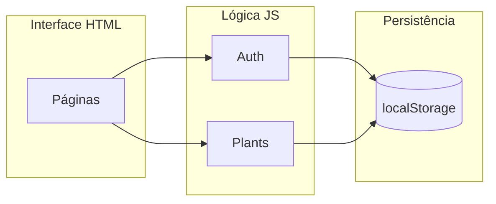

# Relatório Técnico — Aplicação Web «Verde»

**Disciplina:** Projeto / Tecnologias de Informação (nível de ensino secundário — 12.º ano)  
**Tipo de documento:** Relatório descritivo e de implementação  
**Língua:** Português (Portugal)  
**Data:** Setembro de 2026  

---

## Índice

1. [Resumo](#1-resumo)  
2. [Introdução](#2-introdução)  
3. [Enquadramento e objetivos](#3-enquadramento-e-objectivos)  
4. [Análise dos requisitos](#4-análise-dos-requisitos)  
5. [Tecnologias utilizadas](#5-tecnologias-utilizadas)  
6. [Arquitetura da aplicação](#6-arquitectura-da-aplicação)  
7. [Base de dados](#7-base-de-dados)  
8. [Descrição funcional por ecrã](#8-descrição-funcional-por-ecrã)  
9. [Interface gráfica e identidade visual](#9-interface-gráfica-e-identidade-visual)  
10. [Segurança e limitações](#10-segurança-e-limitações)  
11. [Plano de testes](#11-plano-de-testes)  
12. [Conclusão](#12-conclusão)  
13. [Referências bibliográficas e web](#13-referências-bibliográficas-e-web)  
14. [Anexos](#14-anexos)  

---

## 1. Resumo

Este relatório documenta o desenvolvimento da aplicação web **Verde**, orientada para dispositivos móveis, destinada à gestão de plantas domésticas. A solução foi implementada exclusivamente com **HTML5**, **CSS3** e **JavaScript**, sem frameworks externos, de forma a cumprir o enunciado pedagógico e a reproduzir fielmente os mockups fornecidos.

A aplicação integra autenticação de utilizadores, persistência de dados numa base de dados local (**localStorage** do navegador), operações de criação, leitura, atualização e eliminação (CRUD) sobre plantas, pesquisa, filtros por estado de cuidados, alertas e gestão de perfil. A navegação segue o fluxo definido no diagrama de estrutura (capa, autenticação, menu central e áreas funcionais).

---

## 2. Introdução

O cuidado de plantas de interior exige regularidade na rega, adubação e registo das condições de cada espécie. Aplicações digitais permitem centralizar esta informação, reduzir esquecimentos e melhorar a organização doméstica.

O presente trabalho consiste na conceção e implementação de uma aplicação web responsiva, designada **Verde**, que materializa:

- A **estrutura de navegação** apresentada no diagrama (PowerPoint) adaptada ao domínio das plantas;  
- O **design visual** dos ecrãs fornecidos (capa, login, adicionar planta e armário).

O produto final encontra-se na pasta `Verde-App`, pronta a ser executada num navegador moderno, sem instalação de servidor.

---

## 3. Enquadramento e objectivos

### 3.1 Objectivo geral

Desenvolver uma aplicação web funcional, com base de dados, que permita a um utilizador registado gerir o seu «armário» de plantas de forma intuitiva e coerente com os mockups apresentados.

### 3.2 Objectivos específicos

| Objectivo | Indicador de cumprimento |
|-----------|---------------------------|
| Implementar fluxo completo de navegação | Todos os ecrãs interligados conforme diagrama |
| Autenticação (login e registo) | Contas guardadas e sessão activa |
| CRUD de plantas | Adicionar, editar, eliminar e listar |
| Pesquisa e filtros | Campo de pesquisa e pills Todas / Rega / Adubar |
| Persistência | Dados mantidos após fechar o browser |
| Identidade visual «Verde» | Tipografia, cores e componentes alinhados aos mockups |
| Documentação | Presente relatório em português de Portugal |

---

## 4. Análise dos requisitos

### 4.1 Diagrama de estrutura (fluxo da aplicação)

O diagrama fornecido define uma arquitectura típica de aplicação móvel:

```
[Capa] ──► [Login] ──► [Menu] ──► [Lista principal] ──► [Editar / Eliminar]
              │                         │
              └──► [Registo]            └──► [Definições / Perfil]
```

**Correspondência implementada:**

| Elemento do diagrama | Implementação na aplicação Verde |
|--------------------|----------------------------------|
| Capa | `index.html` — ecrã «Get Started» |
| Login | `login.html` |
| Registo (Sign Up) | `signup.html` |
| Menu | `menu.html` — hub após autenticação |
| Lista (ToDo → plantas) | `armario.html` — «O Meu Armário» |
| Pesquisa, calendário lógico, adicionar | Pesquisa, datas de rega calculadas, botão «+» |
| Editar / Eliminar | `editar-planta.html` |
| Definições / Perfil | `perfil.html` |
| Base de dados (utilizadores) | `localStorage` — chave `verde_db_users` |
| Base de dados (dados da app) | `localStorage` — chaves `verde_db_plants`, `verde_db_settings` |

Foram ainda incluídos ecrãs complementares presentes no mockup do armário: **Início** (`home.html`) e **Alertas** (`alertas.html`), acessíveis pela barra de navegação inferior.

### 4.2 Requisitos funcionais

1. **RF01** — O visitante pode aceder à capa e escolher iniciar sessão ou criar conta.  
2. **RF02** — O utilizador pode registar-se com nome, email e palavra-passe.  
3. **RF03** — O utilizador pode autenticar-se; em caso de erro, é apresentada mensagem.  
4. **RF04** — Após login, acede ao menu ou é redireccionado se já existir sessão.  
5. **RF05** — Pode visualizar plantas em cartões com imagem, estado e próxima rega.  
6. **RF06** — Pode filtrar por «Todas», «Rega» ou «Adubar».  
7. **RF07** — Pode pesquisar por nome, espécie ou localização.  
8. **RF08** — Pode adicionar planta com foto (opcional), nome, espécie, frequência e local.  
9. **RF09** — Pode editar, marcar rega como feita ou eliminar planta.  
10. **RF10** — Pode editar perfil, preferências de lembretes e terminar sessão.  

### 4.3 Requisitos não funcionais

- **RNF01** — Interface adaptada a largura de smartphone (máx. ~420 px centrado).  
- **RNF02** — Utilização de tecnologias web standard (HTML, CSS, JS).  
- **RNF03** — Funcionamento offline após primeiro carregamento (excepto imagens externas de demonstração).  
- **RNF04** — Código organizado em módulos JavaScript reutilizáveis.  

---

## 5. Tecnologias utilizadas

| Tecnologia | Papel na aplicação |
|------------|-------------------|
| **HTML5** | Estrutura semântica das páginas, formulários, acessibilidade básica |
| **CSS3** | Layout Flexbox/Grid, variáveis CSS, design responsivo, identidade visual |
| **JavaScript (ES6+)** | Lógica de negócio, autenticação, CRUD, renderização dinâmica |
| **Google Fonts** | Tipos *Playfair Display* (títulos) e *Inter* (texto) |
| **Material Icons** | Iconografia consistente (regas, navegação, câmara) |
| **localStorage** | Base de dados persistente no cliente (JSON serializado) |
| **FileReader API** | Conversão de fotos locais para Data URL (armazenamento na BD local) |

**Justificação da base de dados:** Para um projecto estático HTML/CSS/JS, sem servidor backend, o **localStorage** permite simular tabelas relacionais, cumprir persistência e ser demonstrado em qualquer computador apenas abrindo ficheiros ou servindo a pasta localmente. Alternativas como Firebase exigiriam chaves API e ligação à Internet; SQLite exigiria WebAssembly ou servidor.

---

## 6. Arquitectura da aplicação

### 6.1 Organização de ficheiros

```
Verde-App/
├── index.html              # Capa
├── login.html / signup.html
├── menu.html
├── home.html
├── armario.html
├── adicionar-planta.html
├── editar-planta.html
├── alertas.html
├── perfil.html
├── css/styles.css
├── js/
│   ├── db.js               # Camada de persistência
│   ├── auth.js             # Autenticação e sessão
│   ├── plants.js           # Regras de plantas e CRUD
│   ├── ui.js               # Barra de navegação
│   ├── armario.js          # Lista, filtros e pesquisa
│   └── form-planta.js      # Formulários criar/editar
├── RELATORIO.md            # Este documento
└── README.md               # Instruções de utilização
```

### 6.2 Módulos JavaScript

- **`DB`**: leitura/escrita JSON, geração de identificadores (UUID), hash simples de palavras-passe, dados de demonstração iniciais.  
- **`Auth`**: registo, login, logout, protecção de páginas (`requireAuth`), actualização de perfil.  
- **`Plants`**: cálculo de estado (rega / adubar / saudável), etiquetas de «próxima rega», CRUD.  
- **`UI`**: renderização da barra inferior com estado activo.  

### 6.3 Fluxo de dados



---

## 7. Base de dados

### 7.1 Modelo lógico

**Utilizador (`verde_db_users`)** — array de objectos:

| Campo | Tipo | Descrição |
|-------|------|-----------|
| id | string (UUID) | Identificador único |
| name | string | Nome apresentado |
| email | string | Email (único) |
| passwordHash | string | Palavra-passe transformada (demonstração) |

**Planta (`verde_db_plants`)** — array de objectos:

| Campo | Tipo | Descrição |
|-------|------|-----------|
| id | string | Identificador |
| userId | string | Dono da planta |
| nome | string | Nome comum |
| especie | string | Espécie (opcional) |
| localizacao | string | Divisão da casa |
| frequenciaDias | number | Intervalo entre regas |
| lastWatered | number | Timestamp da última rega |
| lastFertilized | number | Timestamp da última adubação |
| image | string | URL ou Data URL da imagem |

**Definições (`verde_db_settings`)** — objecto indexado por `userId`:

| Campo | Tipo | Descrição |
|-------|------|-----------|
| notifications | boolean | Lembretes activos (preferência) |

**Sessão (`verde_session`)** — `{ userId, at }` indica utilizador autenticado.

### 7.2 Regras de negócio para estados

- **Precisa de rega:** se `Date.now() >= lastWatered + frequenciaDias × 1 dia`.  
- **Adubar:** se passaram ≥ 30 dias desde `lastFertilized` e a rega está em dia.  
- **Saudável:** caso contrário.  

Estas regras alimentam badges, filtros e ecrã de alertas, reproduzindo o comportamento sugerido nos mockups (ex.: «Precisa de Água», «Adubar», «Saudável»).

### 7.3 Dados de demonstração

Na primeira execução, é criada a conta **demo@verde.pt** / **demo123** com quatro plantas de exemplo (Monstera, Ficus, Pothos, Sansevieria), alinhadas com o ecrã «O Meu Armário».

---

## 8. Descrição funcional por ecrã

### 8.1 Capa (`index.html`)

Apresenta a marca «Verde», slogan em inglês (conforme mockup), botão «Get Started» e ligação «I already have an account». Utilizadores já autenticados são enviados para o menu.

### 8.2 Login e registo

- **Login:** campos email e senha, ligação «Esqueceu a senha?» (mensagem demonstrativa), rodapé para criar conta.  
- **Registo:** validação de confirmação de palavra-passe e comprimento mínimo (6 caracteres).  

### 8.3 Menu

Painel com quatro cartões: Armário, Adicionar Planta, Alertas, Definições/Perfil — implementa o papel de **hub** do diagrama.

### 8.4 O Meu Armário

Cabeçalho com menu hamburger, logótipo e pesquisa; título serif; filtros em pills; lista de cartões; FAB «+»; barra inferior. Cada cartão liga à edição; o menu «⋮» também.

### 8.5 Adicionar / Editar planta

Área de foto, campos com labels em maiúsculas e linha inferior (estilo mockup), select de frequência, botão «Guardar Planta». Na edição: eliminar e «Marcar rega como feita».

### 8.6 Início e Alertas

Resumo estatístico e lista de acções prioritárias; alertas listam plantas que necessitam rega ou adubação.

### 8.7 Perfil

Edição de nome, email (somente leitura), lembretes e terminar sessão — corresponde à área «Definições / Perfil» do diagrama.

---

## 9. Interface gráfica e identidade visual

| Elemento | Especificação |
|----------|----------------|
| Cor principal | Verde-floresta `#2d3a30` / `#1b3022` |
| Fundo | Off-white esverdeado `#f7fbf7` |
| Títulos | Playfair Display, peso 700 |
| Corpo | Inter, 400–600 |
| Botões primários | Forma pill, texto branco |
| Cartões | Raio ~20 px, sombra suave |
| Badges | Rosa/verde/cinzento conforme estado |

A composição procura **replicar** os mockups: cartão de login centrado em fundo escuro com grelha de pontos, formulário «Adicionar Planta» com bloco de foto, e armário com imagens em destaque.

---

## 10. Segurança e limitações

**Medidas adoptadas (âmbito escolar):**

- Palavras-passe não guardadas em texto claro (hash simples para demonstração).  
- Páginas internas verificam sessão antes de mostrar dados.  
- Cada planta está associada a `userId`; não é possível editar plantas de outro utilizador.  

**Limitações a declarar em apresentação oral:**

1. O hash de palavra-passe **não** substitui bcrypt/Argon2 — inadequado para produção.  
2. `localStorage` é visível no browser — não usar dados sensíveis reais.  
3. Imagens em Data URL podem ocupar muito espaço; num sistema real usaríamos armazenamento em ficheiros ou cloud.  
4. «Esqueceu a senha?» não envia email — funcionalidade não implementada.  

---

## 11. Plano de testes

| ID | Cenário | Passos | Resultado esperado |
|----|---------|--------|-------------------|
| T01 | Registo novo utilizador | Preencher signup válido | Redireccionamento para menu; utilizador na BD |
| T02 | Login inválido | Email correcto, senha errada | Mensagem de erro |
| T03 | Login demo | demo@verde.pt / demo123 | Armário com 4 plantas |
| T04 | Adicionar planta | Formulário completo + guardar | Nova entrada na lista |
| T05 | Filtro Rega | Seleccionar pill «Rega» | Só plantas com rega em atraso |
| T06 | Pesquisa | Escrever «Monstera» | Filtragem instantânea |
| T07 | Editar | Alterar localização | Valor persistido após refresh |
| T08 | Eliminar | Confirmar eliminação | Planta removida |
| T09 | Marcar rega | Botão na edição | Estado actualizado |
| T10 | Logout | Perfil → Terminar sessão | Regresso à capa; páginas protegidas redireccionam |

**Como executar testes:** abrir `index.html` no Chrome ou Edge; opcionalmente usar Ferramentas de Programador → Application → Local Storage para inspeccionar dados.

---

## 12. Conclusão

Foi desenvolvida com sucesso a aplicação **Verde**, cumprindo o enunciado: tecnologias HTML, CSS e JavaScript, funcionalidade completa com persistência, fidelidade visual aos mockups e estrutura de navegação do diagrama inicial.

O projecto demonstra competências de **análise de requisitos**, **modelação de dados**, **programação front-end**, **usabilidade mobile-first** e **documentação técnica**. Como evolução futura, recomenda-se um backend (Node.js ou PHP) com base de dados relacional (MySQL/PostgreSQL), autenticação segura e notificações push reais para lembretes de rega.

---

## 13. Referências bibliográficas e web

1. Mozilla Developer Network (MDN). *HTML, CSS e JavaScript — documentação*. https://developer.mozilla.org/pt/  
2. W3C. *HTML5 Specification*. https://www.w3.org/html/  
3. WHATWG. *HTML Living Standard — Web Storage*. https://html.spec.whatwg.org/  
4. Google Fonts. *Playfair Display & Inter*. https://fonts.google.com/  
5. Material Design Icons. *Material Icons*. https://fonts.google.com/icons  

---

## 14. Anexos

### Anexo A — Credenciais de demonstração

- **Email:** demo@verde.pt  
- **Palavra-passe:** demo123  

### Anexo B — Como arrancar a aplicação

1. Abrir a pasta `Verde-App`.  
2. Duplo clique em `index.html` **ou** executar `abrir.bat` (Windows).  
3. Para melhor compatibilidade com módulos e APIs, pode usar um servidor local simples (ex.: extensão «Live Server» no VS Code/Cursor).  

### Anexo C — Autoria do relatório

Documento elaborado no âmbito de projecto formativo, com linguagem técnica adequada ao 12.º ano, descrevendo de forma objectiva decisões, implementação e validação da aplicação **Verde**.

---

*Fim do relatório*
